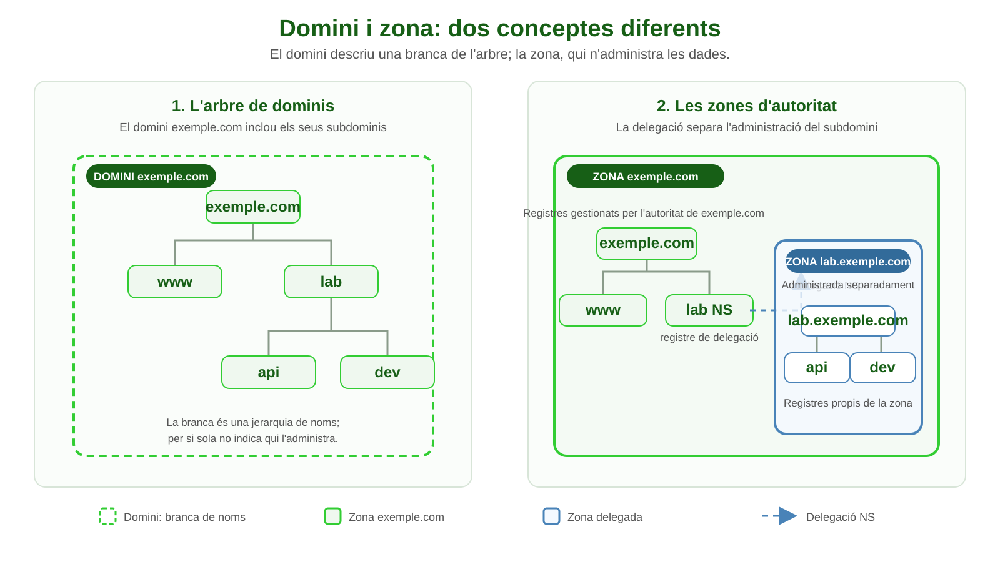

# Unitat 4: Sistema de noms de domini (DNS)

**Mòdul:** Serveis de Xarxa i Internet  
**Cicle:** Administració de Sistemes Informàtics en Xarxa

Note:
Presentació basada en els apunts de la Unitat 4, revisada per reflectir l'estat actual dels estàndards i dels serveis DNS.

---

## Objectius

En acabar, hauràs de poder:

* Explicar per què DNS és jeràrquic i distribuït.
* Diferenciar dominis, zones i tipus de servidors.
* Seguir una resolució recursiva i una resolució iterativa.
* Llegir els registres DNS més habituals.
* Entendre DNSSEC, DNS xifrat i les mesures bàsiques de seguretat.

---

## De noms a adreces

* Les aplicacions fan servir noms fàcils de recordar; la xarxa lliura paquets a adreces IP.
* DNS (*Domain Name System*) és una **base de dades distribuïda i jeràrquica** per consultar noms i altres dades.
* DNS no és només una agenda de noms → IP: també publica correu, delegacions, polítiques i altres serveis.
* El fitxer local `hosts` encara pot contenir excepcions, però no substitueix DNS a escala d'Internet.

Note:
La resolució concreta d'un sistema operatiu pot consultar memòria cau, fitxer hosts, DNS o altres serveis locals. L'ordre depèn del sistema i de la seva configuració; no hi ha una única seqüència universal.

---

## L'arbre de noms

```text
                         .  (arrel)
                        / \
                     com   cat       ← dominis de nivell superior (TLD)
                      |
                   exemple             ← segon nivell
                      |
                    www                 ← subdomini o etiqueta
```

* El punt final representa l'arrel: `www.exemple.com.`
* Les etiquetes es llegeixen des de l'amfitrió cap a l'arrel.
* Els TLD inclouen dominis genèrics (gTLD, com `.com`), de codi de país (ccTLD, com `.es`) i el domini especial `.arpa`.
* `.arpa` és un domini especial per a funcions d'infraestructura, inclosa la resolució inversa.

---

## Classificació dels TLD

| Categoria | Què identifica | Exemples |
|---|---|---|
| **gTLD** — genèrics | Categories d'ús general o comunitats; alguns són oberts i d'altres tenen requisits | `.com`, `.org`, `.app` |
| **sTLD** — genèrics patrocinats | gTLD amb una comunitat o entitat patrocinadora i criteris d'elegibilitat específics | `.edu`, `.aero`, `.cat` |
| **ccTLD** — codis de país o territori | Normalment codis de dues lletres basats en ISO 3166-1 | `.es`, `.fr`, `.de` |
| **Infraestructura** | Domini reservat per a funcions tècniques d'Internet | `.arpa` |
</br>
* Els sTLD són un tipus de gTLD: «patrocinat» no és una categoria paral·lela als dominis genèrics.
* `.cat` és un gTLD patrocinat per a la comunitat lingüística i cultural catalana; no és un ccTLD.
* La classificació administrativa no sempre coincideix amb l'ús que se'n fa: per exemple, un gTLD pot emprar-se com a marca o en una URL creativa.

---

## Noms absoluts, relatius i límits

* Un nom absolut (FQDN) acaba conceptualment en l'arrel: `www.exemple.com.`
* En molts contextos l'arrel final s'omet: `www.exemple.com`.
* Un nom relatiu es completa segons un domini de cerca configurat; això depèn del client.
* Les etiquetes tenen un màxim de **63 octets**.
* El nom codificat en DNS té un màxim de **255 octets**; no són 255 caràcters impresos.
* Els noms DNS no distingeixen majúscules de minúscules, tot i que se'n pot conservar l'escriptura.

Note:
Els noms internacionalitzats poden aparèixer com Unicode a les aplicacions, però al DNS es representen amb codificació IDNA (ASCII/Punycode). Els noms d'amfitrió convencionals segueixen regles de sintaxi més restrictives que els noms DNS en general.

---

## Qui coordina els noms públics?

* L'arrel publica delegacions cap als TLD; els TLD deleguen dominis de segon nivell.
* ICANN coordina polítiques i la gestió de l'arrel; la funció IANA manté dades de la zona arrel.
* Els *registries* operen determinats TLD; els *registrars* tramiten registres per als titulars.
* Registrar un domini no vol dir que ICANN allotgi el lloc web o el servidor DNS.
* L'administració d'una zona es pot delegar a un proveïdor DNS independent del *registrar*.

---

## Domini i zona no són sinònims

* **Domini:** branca de l'espai de noms, per exemple `exemple.com`.
* **Zona:** part de l'arbre administrada com una unitat per servidors autoritatius.
* Una zona pot contenir el domini i subdominis no delegats.
* Si `lab.exemple.com` es delega, la zona `exemple.com` conserva els registres de delegació; una altra zona gestiona `lab.exemple.com`.
* La delegació es publica amb registres `NS` (i, quan cal, registres *glue*).

---

## Domini i zona: exemple



* El contorn discontinu marca el domini; el fons marca l'àmbit d'una zona administrada.
* La zona pare manté la delegació `NS`; la zona filla gestiona els seus registres.

---

## Servidors i rols DNS

* **Autoritatiu:** publica dades oficials d'una o més zones.
* **Primari:** on s'edita la zona; **secundari:** obté una còpia mitjançant transferència.
* Primari i secundari poden respondre autoritativament: el secundari no és una còpia «menys vàlida».
* **Resolutor recursiu:** consulta altres servidors i guarda resultats a la memòria cau.
* **Reenviador:** passa consultes a un altre resolutor, sovint per política o per centralitzar la memòria cau.
* Un mateix programari pot assumir més d'un rol, però cal configurar bé els límits d'autoritat i recursió.

---

## Servidors arrel: què vol dir «13»?

* Hi ha **13 identitats lògiques** de servidors arrel, anomenades de `A` a `M`.
* No són només 13 màquines físiques: les instàncies distribuïdes amb *anycast* en serveixen les consultes arreu del món.
* Els servidors arrel retornen principalment delegacions dels TLD; no resolen tots els noms d'Internet.
* Normalment un resolutor recursiu només els consulta quan no té la resposta a la memòria cau.

https://root-servers.org/

https://www.iana.org/domains/root/db

---

## Com arriba una consulta?

1. Una aplicació demana resoldre un nom al sistema operatiu.
2. El *stub resolver* consulta les fonts locals configurades i, si escau, envia una consulta al resolutor recursiu.
3. Si no té una resposta vàlida a la memòria cau, el recursiu consulta l'arrel, el TLD i el servidor autoritatiu.
4. El recursiu retorna el resultat al client i el desa a la memòria cau durant el TTL.

</br>
</br>

```text
Aplicació → stub del sistema → resolutor recursiu → arrel → TLD → autoritatiu
                                      ← resposta emmagatzemada a la memòria cau
```

---

## Recursiva i iterativa

* **Consulta recursiva:** el client demana al seu resolutor una resposta final o un error.
* **Consulta iterativa:** cada servidor retorna la millor resposta disponible, sovint una referència al servidor següent.
* Habitualment, el stub demana recursió al resolutor; el resolutor segueix les delegacions amb consultes iteratives.
* Una resposta autoritativa ve d'un servidor autoritatiu; una resposta de memòria cau no és autoritativa.
* El TTL limita quant de temps es pot reutilitzar una resposta emmagatzemada.

---

## Memòria cau i resultats negatius

* La memòria cau redueix latència i càrrega als servidors autoritatius.
* El TTL de cada registre determina el temps màxim que els resolutors en poden conservar la resposta.
* També es poden emmagatzemar resultats negatius, com ara que un nom no existeix; el seu temps es determina a partir de la zona SOA.
* Canviar un registre no esborra les còpies que ja són a les memòries cau: la propagació pot trigar fins que caduquin.

---

## Resolució inversa

* Les consultes inverses demanen un registre `PTR`; no es dedueix automàticament de `A` o `AAAA`.
* IPv4: els octets s'inverteixen sota `in-addr.arpa`.
  * `192.0.2.25` → `25.2.0.192.in-addr.arpa`
* IPv6: s'inverteixen els nibbles hexadecimals sota `ip6.arpa`.
* El titular del bloc d'adreces (o el seu delegat) administra aquesta zona.
* Una resposta inversa no demostra per si sola la identitat o la confiança en un equip.

---

## Registres de recursos (RR)

Un registre de recursos (RR) associa un nom DNS amb dades d'un tipus determinat.

| Tipus | Funció |
|---|---|
| `A` / `AAAA` | Adreça IPv4 / IPv6 |
| `CNAME` | Àlies cap a un altre nom canònic |
| `NS` / `SOA` | Delegació de noms / dades principals de la zona |
| `MX` | Servidors de correu, amb prioritat |
| `PTR` | Nom associat a una adreça en una zona inversa |
| `TXT` / `CAA` | Text de verificació o política d'emissió de certificats |
| `SRV` / `HTTPS` | Descobriment de serveis / paràmetres de serveis web |

Note:
`HINFO` existeix a l'estàndard però és rar en ús públic; no s'ha de publicar informació d'inventari innecessària. El registre `HTTPS` (SVCB) és més recent que els tipus habituals dels apunts.

---

## Registre de recursos (RR)

En un fitxer de zona, la forma habitual és `nom [TTL] [classe] tipus dades`. Els camps TTL i classe es poden ometre si s'apliquen els valors per defecte de la zona.

| Camp | Descripció |
|---|---|
| **Nom** (*owner name*) | Nom DNS al qual pertany el registre; per exemple, `www.exemple.com.` |
| **TTL** (*Time To Live*) | Temps, en segons, que els resolutors poden conservar el registre a la memòria cau. |
| **Classe** | Classe de xarxa; a Internet s'utilitza habitualment `IN`. |
| **Tipus** | Indica quina mena de dada conté el registre, com ara `A`, `AAAA`, `MX` o `NS`. |
| **Dades** (*RDATA*) | Valor del registre; el format depèn del tipus, com una adreça IP o un nom de servidor. |
</br>

```text
www.exemple.com.  3600  IN  A  192.0.2.10
└──── nom ─────┘  TTL   classe tipus └─ dades ─┘
```

---

## Exemple de zona DNS

```dns
$ORIGIN exemple.com.
$TTL 3600
@  IN SOA ns1.exemple.com. hostmaster.exemple.com. (
      2026110401 ; sèrie
      3600       ; refresh
      900        ; retry
      1209600    ; expire
      300 )      ; TTL negatiu
@      IN NS    ns1.exemple.com.
@      IN MX 10 mail.exemple.com.
www    IN A     192.0.2.10
www    IN AAAA  2001:db8::10
```

* `@` representa l'origen de la zona.
* Els noms que acaben en punt són absoluts; els altres són relatius a `$ORIGIN`.
* `192.0.2.0/24` i `2001:db8::/32` són blocs reservats per a documentació.

---

## Alias i noms canònics

* `CNAME` crea un àlies que apunta a un altre nom, no directament a una adreça.
* El nom amb `CNAME` no hauria de tenir altres registres de dades al mateix nom.
* No es pot posar un `CNAME` a l'apex d'una zona DNS convencional, perquè hi ha d'haver `SOA` i `NS`.
* Alguns proveïdors ofereixen *ALIAS* o *CNAME flattening* a l'apex; són extensions del proveïdor, no un tipus de registre DNS estàndard.

---

## Transferències de zona

* **AXFR:** transferència completa; **IXFR:** transferència incremental quan és possible.
* Es fan normalment sobre TCP; les consultes DNS ordinàries també poden fer servir TCP.
* El registre `SOA` inclou el número de sèrie que permet detectar canvis.
* `NOTIFY` avisa els secundaris que pot haver-hi una versió nova.
* Restringeix AXFR als secundaris autoritzats i autentica les transferències quan sigui possible (per exemple, amb TSIG).

---

## Actualitzacions dinàmiques

* DNS Dynamic Update permet modificar registres d'una zona sense editar i recarregar manualment el fitxer.
* És útil, per exemple, per integrar DHCP amb DNS en xarxes gestionades.
* No és el mateix que un servei comercial de «DNS dinàmic» per actualitzar un nom quan canvia la IP pública.
* No permetis actualitzacions anònimes: aplica autenticació, autoritzacions i registres d'auditoria (p. ex., TSIG o GSS-TSIG).

---

## Transport DNS: ports i opcions

| Mecanisme | Transport habitual | Què aporta |
|---|---|---|
| DNS clàssic | UDP o TCP, port 53 | Consultes i respostes; TCP també és necessari per a operacions com AXFR |
| DNS over TLS (DoT) | TCP, port 853 | Xifra el tram entre client i resolutor |
| DNS over HTTPS (DoH) | HTTPS, habitualment port 443 | Integra DNS xifrat dins HTTPS |
| DNS over QUIC (DoQ) | QUIC, habitualment port 853 | DNS xifrat sobre QUIC |

* UDP/53 no és l'única manera de transportar DNS; TCP/53 és part del protocol.
* DoH, DoT i DoQ xifren el trànsit fins al resolutor triat, però no xifren DNS fins al servidor autoritatiu.
* El xifratge del transport no substitueix DNSSEC ni garanteix que la política de privacitat del resolutor sigui adequada.

---

## DNSSEC: autenticitat, no confidencialitat

* DNSSEC permet validar l'origen i la integritat de les dades DNS mitjançant signatures digitals i una cadena de confiança.
* Registres clau: `DNSKEY`, `DS`, `RRSIG` i, per demostrar absència, `NSEC` o `NSEC3`.
* El resolutor validador comprova la cadena fins a una ancoratge de confiança.
* DNSSEC **no xifra** consultes ni respostes, no amaga els noms consultats i no evita una denegació de servei.
* Cal distingir entre una resposta signada i una resposta efectivament validada pel client o resolutor.

---

## Amenaces i defenses

* **Enverinament de memòria cau / suplantació:** mantén els resolutors actualitzats i activa validació DNSSEC quan sigui viable.
* **Amplificació i denegació de servei:** evita resolutors recursius oberts a Internet; limita recursió als clients previstos.
* **Exposició de l'estructura interna:** limita transferències de zona i evita publicar noms interns innecessaris.
* **Canvis no autoritzats:** restringeix actualitzacions dinàmiques; protegeix credencials i fitxers de zona.
* **Interrupció del servei:** desplega autoritatius redundants en xarxes i ubicacions independents; monitoritza i mantén còpies de seguretat.

---

## RDAP, WHOIS i eines de consulta

* WHOIS és un protocol i un conjunt de serveis històrics per consultar dades de registre; no resol noms DNS.
* Per a dades de registre de dominis genèrics, **RDAP** és el substitut estandarditzat de WHOIS en molts serveis de registre.
* La disponibilitat i el nivell de dades personals depenen de la política i la normativa aplicables.
* `dig` és una eina flexible de diagnòstic; `nslookup` i `host` també són habituals.
* Eines de consulta de registre: client RDAP o portal del *registry/registrar*.

---

## RDAP i WHOIS

Per consultar les dades de registre del domini reservat `example.com`:

* **Navegador:** [Consulta RDAP de example.com](https://rdap.org/domain/example.com)
* **Terminal amb RDAP:**

```bash
curl -L https://rdap.org/domain/example.com
```

* **Terminal amb el client WHOIS tradicional:**

```bash
whois example.com
```

* RDAP retorna dades estructurades en JSON; segons el registre, poden incloure registrador, estats, dates i servidors de noms.
* La informació personal pot estar omesa o redactada. Les dades exactes varien segons el domini i el *registry*.

---

## Diagnòstic amb `dig`

```bash
dig www.example.com A
dig www.example.com AAAA
dig example.com MX
dig -x 192.0.2.25
dig +trace www.example.com
dig @1.1.1.1 www.example.com
```

* `+trace` mostra el seguiment iteratiu de delegacions des de l'arrel.
* `@servidor` selecciona el servidor consultat.
* Compara la resposta autoritativa amb la resposta del resolutor recursiu i fixa't en TTL, `status` i flags.
* Utilitza noms i adreces de documentació en exemples; no assumeixis que una IP DNS pública és adequada per a totes les xarxes.

---

## Idees clau

* DNS és jeràrquic, distribuït i basat en delegació i memòria cau.
* El resolutor recursiu treballa pel client; els servidors autoritatius publiquen les dades de zona.
* Els registres `A`, `AAAA`, `CNAME`, `MX`, `NS`, `SOA` i `PTR` cobreixen molts casos bàsics.
* DNSSEC valida dades; DoH/DoT/DoQ xifren un tram del transport. Són proteccions diferents.
* Les transferències i actualitzacions s'han de restringir i autenticar.

---

## Referències i estàndards

* [RFC 1034 — Concepts and Facilities](https://www.rfc-editor.org/rfc/rfc1034)
* [RFC 1035 — Implementation and Specification](https://www.rfc-editor.org/rfc/rfc1035)
* [RFC 3596 — DNS Extensions to Support IP Version 6](https://www.rfc-editor.org/rfc/rfc3596)
* [RFC 4033 — DNS Security Introduction and Requirements](https://www.rfc-editor.org/rfc/rfc4033)
* [RFC 2136 — Dynamic Updates in the Domain Name System](https://www.rfc-editor.org/rfc/rfc2136)
* [RFC 7766 — DNS Transport over TCP](https://www.rfc-editor.org/rfc/rfc7766)
* [RFC 7858 — DNS over TLS](https://www.rfc-editor.org/rfc/rfc7858), [RFC 8484 — DNS over HTTPS](https://www.rfc-editor.org/rfc/rfc8484), [RFC 9250 — DNS over QUIC](https://www.rfc-editor.org/rfc/rfc9250)
* [RFC 9460 — SVCB and HTTPS Resource Records](https://www.rfc-editor.org/rfc/rfc9460) · [RFC 9082 — RDAP Query Format](https://www.rfc-editor.org/rfc/rfc9082)
* [ICANN — RDAP](https://www.icann.org/rdap) · [Root Server Technical Operations](https://root-servers.org/)

---

# Gràcies!

**Preguntes i debat**

* Per què un resolutor recursiu no necessita preguntar sempre als servidors arrel?
* Quina diferència hi ha entre DNSSEC i DNS over HTTPS?
* Qui ha d'autoritzar i protegir una transferència de zona?
